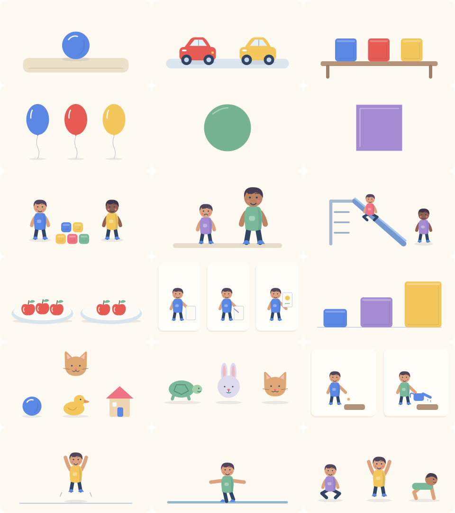

# Matriz editorial do catálogo inicial de quizzes

Data da preparação: 2026-10-12. Escopo do lote 05: **45 quizzes e 213 perguntas**, com três quizzes em cada uma das 15 faixas. Os arquivos JSON de importação ficam em `prisma/quiz-data/`; suas questões, alternativas e gabaritos são insumos do importador executado no servidor.

O conteúdo foi preparado e conferido quanto a contagem, estrutura, alternativas distintas, resposta única e explicação. **Revisão pedagógica humana e revisão técnica de Enfermagem ainda estão pendentes**: todas as entradas têm `review.status: PENDING`, `reviewedBy: null` e `reviewedAt: null`. A importação como rascunho não é aprovação editorial. Em 2026-10-13, o responsável pelo projeto confirmou no chat: “Eu reviso os quizzes preparados”. Ele fica como responsável pela revisão do catálogo, incluindo Infantil e Enfermagem. A atribuição não registra uma revisão já realizada; os campos `reviewedBy`/`reviewedAt` permanecem nulos até a avaliação do conteúdo.

## Distribuição e objetivos

| Faixa | `schoolYear` | Quizzes | Perguntas por quiz | Total de perguntas | Responsável pela revisão |
|---|---:|---:|---:|---:|---|
| Infantil 4 | -1 | 3 | 3 | 9 | Responsável pelo projeto — pendente |
| Infantil 5 | -2 | 3 | 3 | 9 | Responsável pelo projeto — pendente |
| Fundamental, 1º ao 5º ano | 1–5 | 15 | 5 | 75 | Responsável pelo projeto — pendente |
| Fundamental, 6º ao 9º ano | 6–9 | 12 | 5 | 60 | Responsável pelo projeto — pendente |
| Médio, 1ª à 3ª série | 10–12 | 9 | 5 | 45 | Responsável pelo projeto — pendente |
| Enfermagem | 0 | 3 | 5 | 15 | Responsável pelo projeto — pendente |
| **Total** | **15 faixas** | **45** | — | **213** | **Pendente** |

Os temas são introdutórios, selecionados por faixa para oferecer pequenas atividades de aprendizagem. Três quizzes por ano constituem o catálogo inicial, não a cobertura completa de disciplinas, habilidades ou currículo. Foram reutilizadas somente disciplinas já existentes no seed, sem criar novos slugs. Todos os quizzes desta matriz começam com `contentVersion: 1`; `activityKey` e `originKey` identificam o conteúdo sem depender do título ou da versão.

A Educação Infantil conta com três alternativas por pergunta, enunciados curtos, ilustração, texto alternativo, áudio de enunciado/alternativas e transcrição em todas as 18 perguntas. O desenho e a ordem das figuras precisam ser avaliados junto com texto e áudio. O uso com mediação de um adulto é apropriado nessa faixa. Cores, quantidades, lateralidade e sequência aparecem explicitamente no texto alternativo quando fazem parte da informação visual necessária.

Nos demais segmentos, cada pergunta tem três alternativas e uma explicação de aprendizagem. As alternativas corretas ocupam posições variadas registradas no arquivo; o importador não seleciona temas ou perguntas ao acaso. Quinze questões incluem curiosidades ou informações de reforço (`funFact`) exibidas somente depois de confirmar a resposta. Em Genética, os modelos e suas condições são explicitados; em Física, unidades e hipóteses do problema são informadas.

### Prévia das ilustrações

As 18 cenas usam formas arredondadas, personagens com expressões, roupas e cabelos, cores suaves e sombras discretas. A revisão de cor vermelha preserva sua distinção das cores de decoração. Os IDs anteriores continuam registrados para preservar snapshots.

A narração em português lê o enunciado e todas as alternativas, com transcrição equivalente. Ilustração, áudio e compreensão infantil ainda exigem revisão humana antes de publicar.

## Entradas para revisão

A coluna de revisão descreve o estado editorial, separado do status técnico da atividade no banco. A revisão deve examinar o JSON correspondente e, na Educação Infantil, seus assets. Esta tabela omite gabaritos.

| Chave estável (`activityKey`) | Faixa | Disciplina | Tema de aprendizagem | Perguntas | Revisão |
|---|---|---|---|---:|---|
| `infantil-4-contar-brincando` | Infantil 4 | Espaços, tempos, quantidades, relações e transformações | Contagem de um a três | 3 | PENDING |
| `infantil-4-conviver-e-sentir` | Infantil 4 | O eu, o outro e o nós | Convivência, ajuda e turnos | 3 | PENDING |
| `infantil-4-cores-e-formas` | Infantil 4 | Traços, sons, cores e formas | Cores e formas do cotidiano | 3 | PENDING |
| `infantil-5-comparar-e-ordenar` | Infantil 5 | Espaços, tempos, quantidades, relações e transformações | Comparação e sequência temporal | 3 | PENDING |
| `infantil-5-corpo-em-movimento` | Infantil 5 | Corpo, gestos e movimentos | Movimentos e consciência corporal | 3 | PENDING |
| `infantil-5-rimas-e-historias` | Infantil 5 | Escuta, fala, pensamento e imaginação | Rimas e compreensão de histórias | 3 | PENDING |
| `fundamental-1-numeros-brinquedos` | 1º ano do Fundamental | Matemática | Contagem e operações até dez | 5 | PENDING |
| `fundamental-1-palavras-do-dia` | 1º ano do Fundamental | Português | Letras, sílabas e palavras familiares | 5 | PENDING |
| `fundamental-1-seres-e-objetos` | 1º ano do Fundamental | Ciências | Seres vivos e materiais do cotidiano | 5 | PENDING |
| `fundamental-2-dezenas-e-trocas` | 2º ano do Fundamental | Matemática | Dezenas, unidades e operações simples | 5 | PENDING |
| `fundamental-2-frases-e-pistas` | 2º ano do Fundamental | Português | Compreensão de frases e pontuação | 5 | PENDING |
| `fundamental-2-lugares-e-caminhos` | 2º ano do Fundamental | Geografia | Referências espaciais e cuidados com espaços | 5 | PENDING |
| `fundamental-3-agua-em-viagem` | 3º ano do Fundamental | Ciências | Estados físicos e ciclo da água | 5 | PENDING |
| `fundamental-3-grupos-e-partilhas` | 3º ano do Fundamental | Matemática | Multiplicação e divisão em situações concretas | 5 | PENDING |
| `fundamental-3-ler-bilhetes` | 3º ano do Fundamental | Português | Bilhetes, informações explícitas e inferência | 5 | PENDING |
| `fundamental-4-contar-historias` | 4º ano do Fundamental | Português | Elementos da narrativa e discurso direto | 5 | PENDING |
| `fundamental-4-fontes-e-memorias` | 4º ano do Fundamental | História | Fontes históricas e memória | 5 | PENDING |
| `fundamental-4-partes-do-inteiro` | 4º ano do Fundamental | Matemática | Frações simples e equivalência | 5 | PENDING |
| `fundamental-5-brasil-no-mapa` | 5º ano do Fundamental | Geografia | Representações e diversidade do território brasileiro | 5 | PENDING |
| `fundamental-5-decimais-no-dia` | 5º ano do Fundamental | Matemática | Números decimais, medidas e dinheiro | 5 | PENDING |
| `fundamental-5-teia-da-vida` | 5º ano do Fundamental | Ciências | Cadeias alimentares e ambiente | 5 | PENDING |
| `fundamental-6-celulas-e-vida` | 6º ano do Fundamental | Ciências | Células e organização dos seres vivos | 5 | PENDING |
| `fundamental-6-numeros-e-partes` | 6º ano do Fundamental | Matemática | Inteiros e operações com frações | 5 | PENDING |
| `fundamental-6-textos-e-intencoes` | 6º ano do Fundamental | Português | Gêneros textuais e finalidade comunicativa | 5 | PENDING |
| `fundamental-7-cidades-em-rede` | 7º ano do Fundamental | Geografia | Urbanização, mobilidade e redes | 5 | PENDING |
| `fundamental-7-english-daily-life` | 7º ano do Fundamental | Inglês | Vocabulário e presente simples | 5 | PENDING |
| `fundamental-7-razoes-do-cotidiano` | 7º ano do Fundamental | Matemática | Proporcionalidade e porcentagem | 5 | PENDING |
| `fundamental-8-abolicao-e-cidadania` | 8º ano do Fundamental | História | Escravização, abolição e direitos | 5 | PENDING |
| `fundamental-8-energia-se-transforma` | 8º ano do Fundamental | Ciências | Formas e transformações de energia | 5 | PENDING |
| `fundamental-8-equacoes-em-jogo` | 8º ano do Fundamental | Matemática | Equações do primeiro grau e expressões | 5 | PENDING |
| `fundamental-9-argumentos-e-evidencias` | 9º ano do Fundamental | Português | Argumentação e leitura crítica | 5 | PENDING |
| `fundamental-9-dados-e-relacoes` | 9º ano do Fundamental | Matemática | Função afim e estatística básica | 5 | PENDING |
| `fundamental-9-english-reading-online` | 9º ano do Fundamental | Inglês | Compreensão de mensagens e conectores | 5 | PENDING |
| `medio-1-celulas-por-dentro` | 1ª série do Médio | Biologia | Organelas e organização celular | 5 | PENDING |
| `medio-1-materia-e-misturas` | 1ª série do Médio | Química | Substâncias, misturas e métodos de separação | 5 | PENDING |
| `medio-1-movimento-e-medidas` | 1ª série do Médio | Física | Velocidade média e movimento uniforme | 5 | PENDING |
| `medio-2-chances-e-escolhas` | 2ª série do Médio | Matemática | Contagem e probabilidade | 5 | PENDING |
| `medio-2-genetica-em-modelos` | 2ª série do Médio | Biologia | Conceitos de genética mendeliana | 5 | PENDING |
| `medio-2-trabalho-e-energia` | 2ª série do Médio | Física | Trabalho, energia e potência | 5 | PENDING |
| `medio-3-dados-sem-armadilhas` | 3ª série do Médio | Matemática | Estatística e leitura crítica de dados | 5 | PENDING |
| `medio-3-etica-e-argumentacao` | 3ª série do Médio | Filosofia | Ética, justificação e pensamento crítico | 5 | PENDING |
| `medio-3-sociedade-e-cidadania` | 3ª série do Médio | Sociologia | Socialização, desigualdade e participação | 5 | PENDING |
| `enfermagem-etica-e-registros` | Enfermagem | Enfermagem | Ética profissional e documentação | 5 | PENDING |
| `enfermagem-identificacao-e-comunicacao` | Enfermagem | Enfermagem | Identificação do paciente e comunicação segura | 5 | PENDING |
| `enfermagem-sus-e-equidade` | Enfermagem | Enfermagem | Princípios e organização do SUS | 5 | PENDING |

## Arquivos e conferência

| Arquivo de importação | Quizzes | Perguntas |
|---|---:|---:|
| `prisma/quiz-data/infantil.json` | 6 | 18 |
| `prisma/quiz-data/fundamental-1-5.json` | 15 | 75 |
| `prisma/quiz-data/fundamental-6-9.json` | 12 | 60 |
| `prisma/quiz-data/medio.json` | 9 | 45 |
| `prisma/quiz-data/enfermagem.json` | 3 | 15 |

A revisão de cada entrada deve conferir a resposta, a explicação, a clareza do enunciado, a existência de uma única alternativa defensável, os distratores e a adequação ao ano. Para as mídias infantis, também conferir conteúdo da ilustração, ordem das figuras, qualidade/pronúncia da narração, equivalência da transcrição, contraste e compreensão com tecnologia assistiva. Revisão estrutural automatizada não substitui esses pontos.

Depois da conferência, registrar a identidade de quem revisou, a data ISO, o status `APPROVED` e o `contentHash` correspondente obtido pelo inventário no arquivo; usar somente uma aprovação realmente obtida. O campo de revisão está vinculado à versão do conteúdo. Alterações posteriores exigem nova conferência e, para conteúdo já publicado, uma nova versão preservando as chaves de origem. A política de importação, validação e publicação está no [guia de quizzes](guia-quizzes.md).

## Fontes e escopo de Enfermagem

As três atividades abordam fundamentos curriculares de ética/documentação, SUS e identificação/comunicação segura. Elas não prescrevem tratamento, dose ou execução de procedimento clínico. **A revisão técnica por responsável habilitado continua PENDING**, inclusive para verificar atualização normativa e adequação ao curso. As fontes foram consultadas em 2026-10-12 e estão registradas também em `sources` de cada quiz.

| Quiz | Base consultada |
|---|---|
| `enfermagem-etica-e-registros` | [Cofen — Código de Ética, Resolução nº 564/2017](https://www.cofen.gov.br/resolucao-cofen-no-5642017/), especialmente autonomia, sigilo e não discriminação; [Cofen — recomendações para registros](https://cofen.gov.br/profissional/recomendacoes-para-registros-de-enfermagem-no-exercicio-da-profissao/), para documentação e autoria. |
| `enfermagem-sus-e-equidade` | [Ministério da Saúde — SUS e seus princípios](https://www.gov.br/saude/pt-br/composicao/saes/sus) e [Equidade em Saúde](https://www.gov.br/saude/pt-br/composicao/saps/equidade-em-saude), para acesso, necessidades e organização da rede. |
| `enfermagem-identificacao-e-comunicacao` | [Ministério da Saúde/Anvisa/Fiocruz — protocolo de identificação](https://www.gov.br/saude/pt-br/composicao/saes/seguranca-do-paciente/publicacoes/protocolos-de-seguranca-do-paciente/protocolo-de-identificacao-do-paciente/view), para identificadores; [Cofen — recomendações para registros](https://cofen.gov.br/profissional/recomendacoes-para-registros-de-enfermagem-no-exercicio-da-profissao/), para continuidade e legibilidade. |

Não foram copiados casos reais, nomes de pacientes, prontuários ou dados pessoais. Fontes e autoria editorial não devem ser transformadas em afirmações de aprovação clínica ou de validação por uma instituição.
